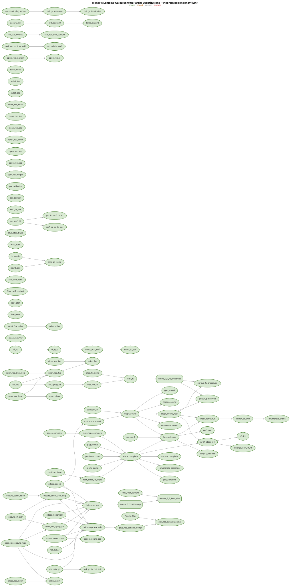
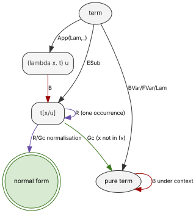
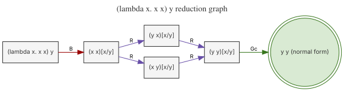

This was (mostly) me being bored in a Monday evening and in an attempt to formalise in Rocq the confluence and normalisation results that Delia Kesner and Shane Ó Conchúir obtain for the lambda calculus of Milner with partial substitutions which is available as arXiv:2312.13270.

## Graphs

The dependency graph covers the six milestones and every edge runs from a dependency to the result that uses it while the node colour encodes the status proved or stated or planned or blocked:

The rule sketch gives the transition system generated by the rules B and Gc and R:

The reduction graph gives the bounded reduct set of the term that applies the duplicating identity to a variable with every edge labelled by its rule and with the normal form marked:

